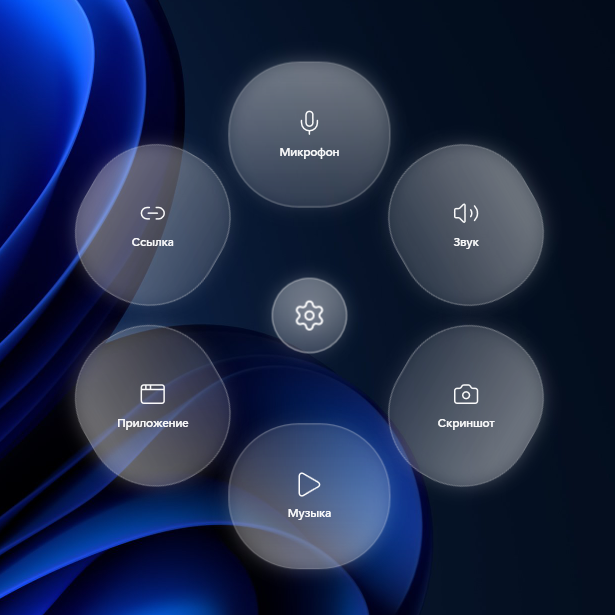

# 檜 Hinoki

Стеклянный цветок по средней кнопке мыши. Настройки — шестерёнка в центре.



## Установка

1. Скачай `Hinoki.exe` со [страницы релизов](../../releases)
2. Запусти — иконка появится в трее

## Как пользоваться

- **Средняя кнопка мыши** — открывает цветок
- **Клик по лепестку** — выполняет действие
- **Клик по шестерёнке** — открывает настройки
- **Esc / клик мимо** — закрывает меню
- **Двойной клик по иконке в трее** — настройки

## Действия лепестков (настройка в разделе «Лепестки»)

Открыть приложение · Звук выкл/вкл · Микрофон выкл/вкл (краснеет когда выключен) · Скриншот в буфер · Пауза музыки · Открыть папку · Команда в CMD · Питание (сон/перезагрузка/выключение) · Свернуть все окна · Открыть ссылку

У каждого лепестка можно задать **цвет** и **горячую клавишу**.

## Сборка

```bat
cd app
bash build.sh
```

Требуется только Windows 10/11 — компилятор csc встроен в систему.

## Очистка

Удалить конфиг: `%APPDATA%\Hinoki\` — вернуть заводские лепестки.
