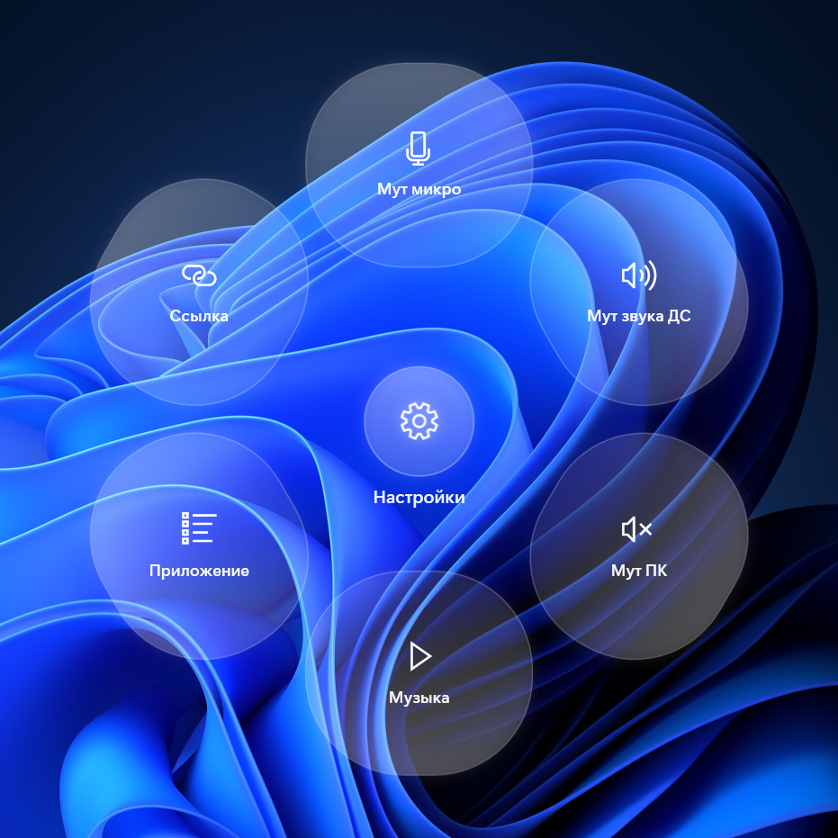

# 檜 Hinoki

**Средняя кнопка мыши — и всё под рукой.** Стеклянный цветок-меню для Windows 10/11: мут в Discord, музыка, любимые приложения — по нажатию колёсика.



## Почему Hinoki

- **Сидит в трее** — без окон, без рекламы, меньше 1 МБ
- **Средняя кнопка мыши** распускает liquid-glass цветок у курсора — без затемнения экрана
- **До 8 лепестков**, каждый настраивается: действие, иконка, название
- **29 действий**: мут/деафен Discord, громкость, треки, скриншоты, блокировка/сон/перезагрузка, диспетчер задач, параметры Windows, калькулятор, эмодзи-панель, буфер обмена, приложения и steam://, ссылки, свои хоткеи
- **Звуки стекла**: мягкий «блум» раскрытия, тик выбора — громкость и каждый звук отдельно
- **Свой характер**: палитра акцентов, прозрачность лепестков, сила свечения, светлое стекло, размер меню, показ подписей
- **Глобальный хоткей** открытия меню без мыши
- **Тумблеры**: анимации, закрытие по клику мимо — полный контроль
- **Настройки v3**: одна стеклянная поверхность без лишних рамок, дропдаун действий не закрывается при выборе, прозрачность центра, кнопка перезапуска
- **Настройки в центре цветка** — минималистичное стеклянное окно с живым превью
- **Ноль зависимостей**: собран на .NET Framework 4.8, встроенном в Windows

## Скачать

Берите последний релиз: **[Hinoki.exe](https://github.com/arseniyru90-afk/hinoki/releases/latest/download/Hinoki.exe)**

Сайт проекта: **https://arseniyru90-afk.github.io/hinoki/**

## Как пользоваться

1. Запустите `Hinoki.exe` — иконка появится в трее
2. Нажмите **среднюю кнопку мыши** — распустится цветок
3. Клик по шестерёнке в центре → настройки: лепестки, цвета, звуки, поведение (Esc или крестик — закрыть)
4. Esc или клик мимо меню — закрывает его

> Мут Discord отправляет `Ctrl+Shift+M` в окно Discord — при желании сочетание меняется в настройках.

## Сборка из исходников

Нужен только Windows и встроенный компилятор:

```bat
cd app
bash build.sh        # или запустите команды из build.sh вручную
```

`build.sh` компилирует `src/*.cs` через `csc.exe` (.NET Framework 4.8) → `build/Hinoki.exe`.

## Структура

```
app/src/        исходники C# (WPF, без XAML)
app/build.sh    скрипт сборки
docs/           сайт проекта (GitHub Pages)
tools/          скрипты генерации иконок и визуальных тестов
```

## License

MIT — делайте что хотите.
